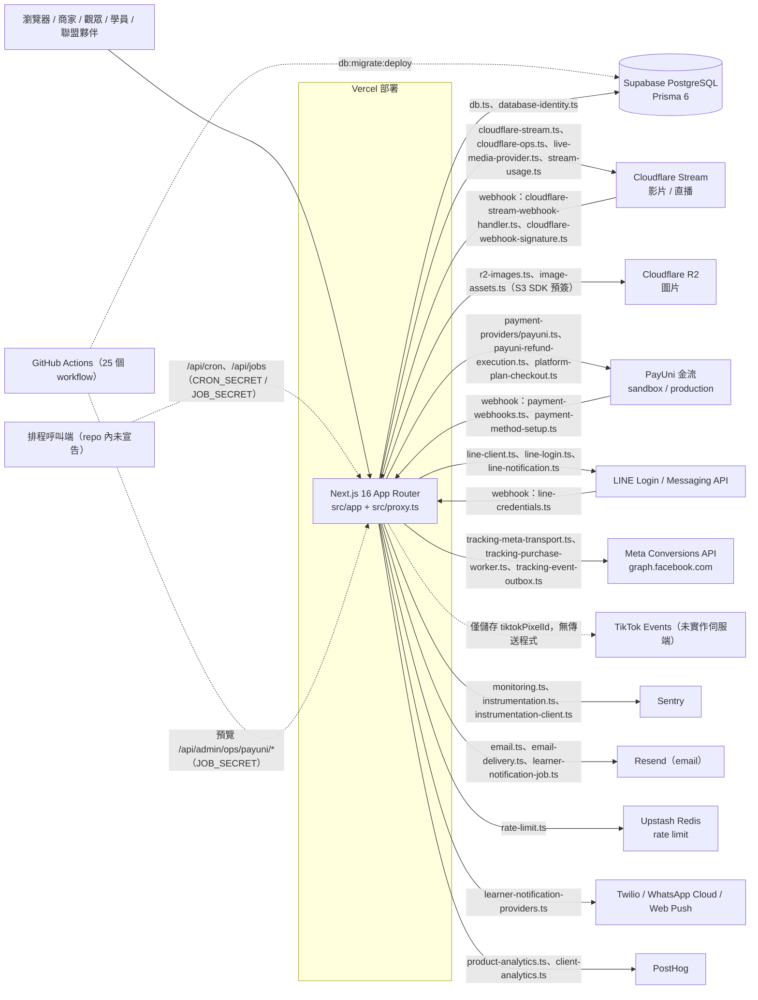

# 01 系統地圖（CelebrateDeal 2026Q4 審查基線）

> 產出者：A-01 唯讀盤點員。本文件只描述「現況」，不含修復建議；審查結論另見後續報告。

## 0. 基線與讀法

- 審查基線：本機 tag `review-baseline-2026Q4` = `78621ca3`（origin/master，commit 數 422）。
- **重要差異：工作目錄 HEAD（`codex/claude-handoff-20261017`，`a0c7ffdc`）並不包含此基線。** `git merge-base --is-ancestor review-baseline-2026Q4 HEAD` 回傳「非祖先」，基線有 15 個 commit 不在 HEAD、HEAD 有 9 個 commit 不在基線。因此本文所有數字都改從 `git archive review-baseline-2026Q4 …` 匯出到暫存目錄後統計（只讀、未動工作目錄與 git 狀態）。依賴工作目錄的人請注意兩者會有出入（例如工作目錄 routes 117／lib 641，基線 routes 122／lib 684）。
- 任務書提到的「約 116 條 route」與「623 個 lib 檔」與基線實測不符；以下以實測為準（route.ts 122 條，其中 api 底下 102 條；`src/lib` 684 個檔，其中 347 個非測試檔）。
- 「用途」欄是依路徑、匯入的 lib 與檔頭註解推斷的一句話，未逐條通讀實作；「防護」欄是對 route 檔做 grep 的啟發式結果，**不是**授權正確性的結論（有些 route 把授權下放到 lib／Server Action，grep 看不到）。
- 取得各數字的命令見第 9 節與 `reports/review-2026Q4/A-01-receipt.md`。

## 1. 路由樹（`src/app`）

共 **144 個 `page.tsx`**、**4 個 `layout.tsx`**（`src/app/layout.tsx`、`(app)/layout.tsx`、`admin/layout.tsx`、`portal/layout.tsx`）、**122 個 `route.ts`**。沒有根層級的 `not-found.tsx`（4 個 `not-found.tsx` 都在子路徑）；另有 `error.tsx` 9 個、`loading.tsx` 32 個、`global-error.tsx` 1 個。沒有 `sitemap`／`robots`／`manifest` 檔案。另有 `src/proxy.ts`（Next 16 取代 middleware）：處理預覽血緣指紋路徑 `/__celebratedeal_wp187_fingerprint.json` 與 `/lp/*` 的公開頁狀態／訪客 cookie。

| 群組 | 頁數 | 主要用途 |
|---|---|---|
| `(app)` 商家後台 | 83 | 登入商家的工作區（見下表） |
| `admin` 平台後台 | 12 | 平台財務／營運：`billing/{dashboard,settlements,payouts,course-payouts,platform-referral-payouts,refund-reconciliation/[id],webhooks,webhooks/[id],stream-reconciliation}`、`cloudflare/videos`、`support-cases`、`support-cases/[id]` |
| `portal` 學員端 | 9 | `/portal`、`[vendorSlug]`、`[vendorSlug]/login`、`[vendorSlug]/notifications`、`learn/[courseId]`（含 `community`、`community/[postId]`）、`start.html`（目錄名，內含 page.tsx）、`start/welcome` |
| `support` 買家支援 | 6 | `/support`、`orders`、`orders/[grantId]`、`orders/[grantId]/delivery/[itemId]`、`requests`、`requests/[id]` |
| `checkout` 結帳 | 4 | `[vendorId]/[productId]`、`offer`、`recover/[grantId]`、`result` |
| `@checkout` 平行／攔截路由 | 3 | 結帳 modal 槽：`page.tsx`、`(.)checkout/[vendorId]/[productId]`、`[...catchAll]`（另有 `default.tsx`） |
| `(viewer)` 觀眾端 | 1 | `/live/[slug]` 直播觀看頁 |
| `affiliate-portal` 聯盟夥伴端 | 3 | `/affiliate-portal`、`[vendorSlug]/[affiliateId]`、`…/remuneration` |
| `lp` 漏斗落地頁 | 3 | `/lp/[slug]`、`/lp/[slug]/[stepPath]`、`…/[stepPath]/checkout` |
| 公開單頁 | 各 1–2 | `p/[slug]`（合作夥伴頁）、`form/[slug]`（報名表單）、`policies`＋`policies/[slug]`（2）、`unsubscribe`、`team-template`、`register`、`login`、`password-reset/{request,confirm}`（2）、`mfa/{setup,verify}`（2）、`verify-registration`、`registration-error`、`merchant-onboarding`、`welcome`＋`welcome/preparing`（2）、根 `/`（1） |
| `browser-qa` | 2 | 內部 QA 頁：`funnel-editor`、`funnel-elements`（另有 `__test/funnel-elements` 目錄） |
| 非頁面 route | 20 | `r/[code]`（平台推薦短連結）、匯出 CSV、`portal/**` 的 JSON／檔案端點、`checkout/upsell`、`lp/…/play`；見第 2 節 |

`(app)` 商家後台頁數（共 83）：billing 10、affiliates 10、settings 7（automations、brand、features、line、security、team、tracking）、lives 7、products 6、messages 5、videos 4、landing-pages 4、forms 4、team-templates 3、projects 3、interaction-scripts 3、interaction-roles 3、support-cases 2、partner-pages 2、orders 2、customers 2、consultations 2、team-performance 1、onboarding 1、dashboard 1、blacklists 1。

注意：`src/app` 底下**沒有** `live`、`r` 的頁面群組：`r` 只有 route handler；`/live/[slug]` 在 `(viewer)` 群組內。

## 2. API 與 Server Actions

### 2.1 Route handlers（122 條 `route.ts`）

- 取得 method 的方式：對每個 route.ts grep `export (async )?function|const (GET|POST|…)`。122 條皆有偵測到 method。
- 防護欄縮寫：`secret`＝JOB_SECRET／CRON_SECRET／WP4 ops 授權；`session`＝商家／平台登入或 MFA 流程；`learner`＝學員或買家支援 grant；`origin`＝同源檢查；`csrf`；`ratelimit`；`sig`＝簽章／解密驗證。
- 有 10 條 route 在 route 檔本身 grep 不到上述任何防護（多數是把授權交給 lib 或 Server Action，例如 `team-funnel/*-actions` 轉呼叫 Server Action；也有刻意公開者如 `health`、`r/[code]`），Critical 審查要逐條確認：`__celebratedeal_wp187_fingerprint.json`、`api/billing/plans/select`、`api/funnel/operations/reports`、`api/health`、`api/interaction-scripts/upsert`、`api/team-funnel/partner-page-actions`、`api/team-funnel/template-actions`、`lp/[slug]/[stepPath]/play`、`portal/notify.link/[...target]`、`r/[code]`。

| 群組 | 條數 |
|---|---|
| `api/admin` | 1 |
| `api/admin/ops` | 28 |
| `api/affiliate-attribution` | 1 |
| `api/affiliate-clicks` | 1 |
| `api/affiliates` | 1 |
| `api/analytics` | 1 |
| `api/auth` | 4 |
| `api/automation` | 1 |
| `api/billing` | 1 |
| `api/checkout` | 1 |
| `api/cloudflare` | 3 |
| `api/cron` | 3 |
| `api/dashboard` | 1 |
| `api/email` | 1 |
| `api/form-submissions` | 2 |
| `api/funnel` | 1 |
| `api/health` | 1 |
| `api/interaction-scripts` | 1 |
| `api/jobs` | 6 |
| `api/live-admission` | 1 |
| `api/live-chat` | 3 |
| `api/live-danmaku` | 2 |
| `api/live-interactions` | 2 |
| `api/live-media` | 1 |
| `api/live-playback-source` | 1 |
| `api/live-presenter` | 1 |
| `api/live-purchase-broadcasts` | 1 |
| `api/live-studio` | 1 |
| `api/media` | 6 |
| `api/orders` | 1 |
| `api/payments` | 3 |
| `api/products` | 1 |
| `api/security` | 1 |
| `api/settings` | 4 |
| `api/stream-usage` | 1 |
| `api/team-funnel` | 9 |
| `api/webhooks` | 4 |
| `非 api（頁面旁的 route handler）` | 20 |
| 合計 | 122 |

#### `api/admin`（1）

| 路徑 | Method | 用途 | 偵測到的防護（grep 啟發式） |
|---|---|---|---|
| `/api/admin/preflight` | GET | 部署前置檢查報告 | secret ratelimit |

#### `api/admin/ops`（28）

| 路徑 | Method | 用途 | 偵測到的防護（grep 啟發式） |
|---|---|---|---|
| `/api/admin/ops/cloudflare/direct-upload` | GET/POST | 營運用 Cloudflare Stream 直傳測試 | secret |
| `/api/admin/ops/cloudflare/live-input` | POST | 營運用 Cloudflare Live Input 建立測試 | secret |
| `/api/admin/ops/payuni/pending-refund-proof` | GET | 唯讀：待處理退款證明（僅 staging host） | secret |
| `/api/admin/ops/payuni/q1-downstream-readonly` | GET | Q1 原始交易下游狀態唯讀診斷 | secret |
| `/api/admin/ops/payuni/q1-original-callback-retry` | POST | Q1 原始交易 callback 重送 | secret |
| `/api/admin/ops/payuni/q1-original-refund-proof` | GET | Q1 原始交易退款證明（唯讀） | secret |
| `/api/admin/ops/payuni/q1-original-schema-recovery` | POST | Q1 原始交易 schema 修復 | secret |
| `/api/admin/ops/payuni/wp4-buyer-callback-retry` | POST | WP4 買家 callback 重送 | secret |
| `/api/admin/ops/payuni/wp4-buyer-existing-reconcile` | POST | WP4 既有買家交易對帳 | secret |
| `/api/admin/ops/payuni/wp4-buyer-existing-refund` | POST | WP4 既有買家交易退款 | secret |
| `/api/admin/ops/payuni/wp4-buyer-existing-state` | POST | WP4 既有買家交易狀態 | secret |
| `/api/admin/ops/payuni/wp4-buyer-order-proof` | POST | WP4 買家訂單證明 | secret |
| `/api/admin/ops/payuni/wp4-buyer-payment-check` | POST | WP4 買家付款檢查 | secret |
| `/api/admin/ops/payuni/wp4-fixture` | POST | WP4 Sandbox 測試資料建立 | secret |
| `/api/admin/ops/payuni/wp4-payment-attempt` | POST | WP4 Sandbox 付款嘗試 | secret |
| `/api/admin/ops/payuni/wp4-preflight` | POST | WP4 Sandbox 前置檢查（165 行，含 session） | secret |
| `/api/admin/ops/payuni/wp4-reconcile` | POST | WP4 Sandbox 對帳 | secret |
| `/api/admin/ops/payuni/wp4-refund` | POST | WP4 Sandbox 退款（至多一筆固定目標） | secret |
| `/api/admin/ops/payuni/wp4-refund-recovery` | POST | WP4 Sandbox 退款復原 | secret |
| `/api/admin/ops/payuni/wp4-session` | DELETE/POST | WP4 Sandbox 預覽 session 建立／刪除 | secret |
| `/api/admin/ops/payuni/wp4-subscription-payment-attempt` | POST | WP4 訂閱付款嘗試 | secret |
| `/api/admin/ops/payuni/wp4-subscription-reconcile` | POST | WP4 訂閱對帳 | secret |
| `/api/admin/ops/payuni/wp4-subscription-refund` | POST | WP4 訂閱退款 | secret |
| `/api/admin/ops/payuni/wp4-subscription-state` | POST | WP4 訂閱狀態 | secret |
| `/api/admin/ops/provider-runtime` | GET | 唯讀：預覽部署的 provider 綁定 | secret |
| `/api/admin/ops/test-analytics` | POST | 營運用分析事件測試 | secret |
| `/api/admin/ops/test-email` | POST | 營運用測試信 | secret |
| `/api/admin/ops/test-monitoring` | POST | 營運用 Sentry 測試 | secret |

#### `api/affiliate-attribution`（1）

| 路徑 | Method | 用途 | 偵測到的防護（grep 啟發式） |
|---|---|---|---|
| `/api/affiliate-attribution/direct-entry` | POST | 直接進站時清除舊歸因 cookie | origin ratelimit |

#### `api/affiliate-clicks`（1）

| 路徑 | Method | 用途 | 偵測到的防護（grep 啟發式） |
|---|---|---|---|
| `/api/affiliate-clicks` | POST | 記錄聯盟連結點擊並簽發歸因 cookie | origin ratelimit |

#### `api/affiliates`（1）

| 路徑 | Method | 用途 | 偵測到的防護（grep 啟發式） |
|---|---|---|---|
| `/api/affiliates/[affiliateId]/remuneration/[snapshotId]/export` | POST | 聯盟報酬快照匯出 | session origin csrf |

#### `api/analytics`（1）

| 路徑 | Method | 用途 | 偵測到的防護（grep 啟發式） |
|---|---|---|---|
| `/api/analytics` | POST | 前端產品／漏斗事件收集（含伺服端追蹤 outbox） | origin ratelimit |

#### `api/auth`（4）

| 路徑 | Method | 用途 | 偵測到的防護（grep 啟發式） |
|---|---|---|---|
| `/api/auth/line/callback` | GET | LINE Login OAuth callback | ratelimit |
| `/api/auth/line/start` | POST | LINE Login 起始 | session learner origin ratelimit |
| `/api/auth/password-reset/confirm` | POST | 重設密碼確認 | origin ratelimit |
| `/api/auth/password-reset/request` | POST | 重設密碼申請 | origin ratelimit |

#### `api/automation`（1）

| 路徑 | Method | 用途 | 偵測到的防護（grep 啟發式） |
|---|---|---|---|
| `/api/automation/vouchers/redeem` | GET | 自動化優惠券連結換取 HttpOnly 結帳 cookie | ratelimit |

#### `api/billing`（1）

| 路徑 | Method | 用途 | 偵測到的防護（grep 啟發式） |
|---|---|---|---|
| `/api/billing/plans/select` | POST | 商家選擇平台方案並導向付款 | （route 檔內未見，疑由 lib／action 內部處理） |

#### `api/checkout`（1）

| 路徑 | Method | 用途 | 偵測到的防護（grep 啟發式） |
|---|---|---|---|
| `/api/checkout/upsell` | POST | 購後加購簽發結帳 token | learner origin csrf ratelimit |

#### `api/cloudflare`（3）

| 路徑 | Method | 用途 | 偵測到的防護（grep 啟發式） |
|---|---|---|---|
| `/api/cloudflare/direct-upload` | POST | 商家影片直傳（Cloudflare Stream） | secret |
| `/api/cloudflare/live-inputs` | POST | 建立 Cloudflare Live Input | secret |
| `/api/cloudflare/stream-webhook` | POST | Cloudflare Stream webhook（簽章驗證在 handler） | sig |

#### `api/cron`（3）

| 路徑 | Method | 用途 | 偵測到的防護（grep 啟發式） |
|---|---|---|---|
| `/api/cron/line-notifications` | GET | LINE 通知排程（CRON_SECRET） | secret |
| `/api/cron/line-notifications/runtime-binding` | GET | LINE 排程執行環境綁定檢查 | secret sig |
| `/api/cron/live-media` | GET | 直播媒體 session 清理 | secret |

#### `api/dashboard`（1）

| 路徑 | Method | 用途 | 偵測到的防護（grep 啟發式） |
|---|---|---|---|
| `/api/dashboard/details` | GET | 儀表板明細 | session |

#### `api/email`（1）

| 路徑 | Method | 用途 | 偵測到的防護（grep 啟發式） |
|---|---|---|---|
| `/api/email/unsubscribe` | POST | 信件退訂 | origin |

#### `api/form-submissions`（2）

| 路徑 | Method | 用途 | 偵測到的防護（grep 啟發式） |
|---|---|---|---|
| `/api/form-submissions` | POST | 報名表單送出（797 行；驗證、歸因、LINE 綁定、追蹤） | origin ratelimit |
| `/api/form-submissions/verify` | POST | 報名表單驗證碼確認 | origin ratelimit |

#### `api/funnel`（1）

| 路徑 | Method | 用途 | 偵測到的防護（grep 啟發式） |
|---|---|---|---|
| `/api/funnel/operations/reports` | GET | 漏斗營運報表（由 lib 內做授權） | （route 檔內未見，疑由 lib／action 內部處理） |

#### `api/health`（1）

| 路徑 | Method | 用途 | 偵測到的防護（grep 啟發式） |
|---|---|---|---|
| `/api/health` | GET | 健康檢查 | （route 檔內未見，疑由 lib／action 內部處理） |

#### `api/interaction-scripts`（1）

| 路徑 | Method | 用途 | 偵測到的防護（grep 啟發式） |
|---|---|---|---|
| `/api/interaction-scripts/upsert` | POST | 互動腳本寫入（原生表單通道） | （route 檔內未見，疑由 lib／action 內部處理） |

#### `api/jobs`（6）

| 路徑 | Method | 用途 | 偵測到的防護（grep 啟發式） |
|---|---|---|---|
| `/api/jobs/billing-cycle` | POST | 月結計費排程（JOB_SECRET） | secret |
| `/api/jobs/electronic-invoices` | POST | 電子發票開立排程 | secret |
| `/api/jobs/email-deliveries` | GET/POST | 信件／學員通知寄送排程（GET=Cron、POST=人工） | secret |
| `/api/jobs/payuni-live-probe` | POST | PayUni 正式環境一次性探針排程 | secret |
| `/api/jobs/tracking-deliveries` | POST | 伺服端追蹤（Meta CAPI）派送排程 | secret |
| `/api/jobs/webhook-retry` | POST | webhook 重試與庫存保留清理 | secret |

#### `api/live-admission`（1）

| 路徑 | Method | 用途 | 偵測到的防護（grep 啟發式） |
|---|---|---|---|
| `/api/live-admission` | DELETE/POST | 觀眾進場配額（簽發／釋放 viewer token） | origin ratelimit |

#### `api/live-chat`（3）

| 路徑 | Method | 用途 | 偵測到的防護（grep 啟發式） |
|---|---|---|---|
| `/api/live-chat/instructor` | GET/POST | 講師端直播聊天 | session origin csrf ratelimit |
| `/api/live-chat/messages` | GET/POST | 公開直播聊天 | origin ratelimit |
| `/api/live-chat/private` | GET/POST | 私訊聊天 | origin csrf ratelimit |

#### `api/live-danmaku`（2）

| 路徑 | Method | 用途 | 偵測到的防護（grep 啟發式） |
|---|---|---|---|
| `/api/live-danmaku` | GET/POST | 彈幕 | session origin ratelimit |
| `/api/live-danmaku/scripted` | GET/POST | 腳本化彈幕 | session origin ratelimit |

#### `api/live-interactions`（2）

| 路徑 | Method | 用途 | 偵測到的防護（grep 啟發式） |
|---|---|---|---|
| `/api/live-interactions` | GET/POST | 直播互動（投票、抽獎、問答；478 行） | origin ratelimit sig |
| `/api/live-interactions/cards` | GET/POST | 互動卡片 | session origin ratelimit |

#### `api/live-media`（1）

| 路徑 | Method | 用途 | 偵測到的防護（grep 啟發式） |
|---|---|---|---|
| `/api/live-media` | POST | 直播媒體 WebRTC session（offer／heartbeat／stop） | session origin ratelimit |

#### `api/live-playback-source`（1）

| 路徑 | Method | 用途 | 偵測到的防護（grep 啟發式） |
|---|---|---|---|
| `/api/live-playback-source` | GET | 取得播放來源 | origin ratelimit |

#### `api/live-presenter`（1）

| 路徑 | Method | 用途 | 偵測到的防護（grep 啟發式） |
|---|---|---|---|
| `/api/live-presenter` | GET/POST | 簡報者畫面狀態 | session origin ratelimit |

#### `api/live-purchase-broadcasts`（1）

| 路徑 | Method | 用途 | 偵測到的防護（grep 啟發式） |
|---|---|---|---|
| `/api/live-purchase-broadcasts` | GET | 直播中購買廣播（跑馬燈） | origin ratelimit |

#### `api/live-studio`（1）

| 路徑 | Method | 用途 | 偵測到的防護（grep 啟發式） |
|---|---|---|---|
| `/api/live-studio/drafts` | POST | 直播工作室草稿存檔 | session |

#### `api/media`（6）

| 路徑 | Method | 用途 | 偵測到的防護（grep 啟發式） |
|---|---|---|---|
| `/api/media/images/complete` | POST | 圖片上傳完成確認（R2） | session |
| `/api/media/images/presign` | POST | 圖片上傳預簽（R2） | session |
| `/api/media/videos/direct-upload` | POST | 影片直傳 | session |
| `/api/media/videos/resumable-upload` | POST | 影片續傳建立 | session |
| `/api/media/videos/resumable-upload/complete` | POST | 影片續傳完成 | session |
| `/api/media/videos/status` | GET | 影片轉檔狀態 | session origin |

#### `api/orders`（1）

| 路徑 | Method | 用途 | 偵測到的防護（grep 啟發式） |
|---|---|---|---|
| `/api/orders/shipping` | POST | 出貨履約狀態轉換（表單通道） | origin |

#### `api/payments`（3）

| 路徑 | Method | 用途 | 偵測到的防護（grep 啟發式） |
|---|---|---|---|
| `/api/payments/checkout` | POST | 結帳建立訂單與付款（1099 行，金額、庫存、歸因、優惠） | origin ratelimit |
| `/api/payments/checkout/admission` | POST | 結帳進場檢查 | origin ratelimit |
| `/api/payments/checkout/recovery` | POST | 結帳復原（購後／棄單） | origin ratelimit |

#### `api/products`（1）

| 路徑 | Method | 用途 | 偵測到的防護（grep 啟發式） |
|---|---|---|---|
| `/api/products/upsert` | POST | 商品寫入（表單通道） | session origin csrf |

#### `api/security`（1）

| 路徑 | Method | 用途 | 偵測到的防護（grep 啟發式） |
|---|---|---|---|
| `/api/security/csp-report` | POST | CSP 違規回報 | ratelimit |

#### `api/settings`（4）

| 路徑 | Method | 用途 | 偵測到的防護（grep 啟發式） |
|---|---|---|---|
| `/api/settings/security/mfa/confirm` | POST | MFA 註冊確認 | session |
| `/api/settings/security/mfa/recovery-codes/dismiss` | POST | 關閉復原碼提示 | session |
| `/api/settings/security/mfa/recovery-codes/regenerate` | POST | 重新產生復原碼 | session |
| `/api/settings/security/mfa/start` | POST | MFA 註冊起始 | session |

#### `api/stream-usage`（1）

| 路徑 | Method | 用途 | 偵測到的防護（grep 啟發式） |
|---|---|---|---|
| `/api/stream-usage` | POST | 觀看時數心跳計量（影響配額與帳單） | origin ratelimit |

#### `api/team-funnel`（9）

| 路徑 | Method | 用途 | 偵測到的防護（grep 啟發式） |
|---|---|---|---|
| `/api/team-funnel/copies` | POST | 團隊漏斗複製 | origin |
| `/api/team-funnel/live-shares` | POST | 夥伴直播分享 | origin |
| `/api/team-funnel/pages` | POST | 夥伴頁面 | origin |
| `/api/team-funnel/partner-page-actions` | POST | 夥伴頁面動作（轉呼叫 Server Action） | （route 檔內未見，疑由 lib／action 內部處理） |
| `/api/team-funnel/partner-profile` | POST | 夥伴個人檔案 | origin |
| `/api/team-funnel/product-slots` | POST | 商品欄位覆寫 | origin |
| `/api/team-funnel/shares` | POST | 頁面分享設定 | origin |
| `/api/team-funnel/template-actions` | POST | 團隊範本動作（轉呼叫 Server Action） | （route 檔內未見，疑由 lib／action 內部處理） |
| `/api/team-funnel/templates` | POST | 團隊範本 | origin |

#### `api/webhooks`（4）

| 路徑 | Method | 用途 | 偵測到的防護（grep 啟發式） |
|---|---|---|---|
| `/api/webhooks/line/[vendorId]` | POST | LINE Messaging webhook（每商家） | sig |
| `/api/webhooks/payment-methods` | POST | PayUni 綁卡 callback（387 行） | sig |
| `/api/webhooks/payments` | HEAD/POST | PayUni 付款 callback（302 行；HEAD+POST） | sig |
| `/api/webhooks/payuni-live-probe` | POST | PayUni 正式探針 callback | sig |

#### `非 api（頁面旁的 route handler）`（20）

| 路徑 | Method | 用途 | 偵測到的防護（grep 啟發式） |
|---|---|---|---|
| `/billing/electronic-invoices/export` | GET | 商家匯出電子發票 CSV | session |
| `/billing/invoices/export` | GET | 商家匯出平台帳單 CSV | session |
| `/lives/[id]/analytics/messages/export` | GET | 匯出單場直播的留言 CSV | session |
| `/__celebratedeal_wp187_fingerprint.json` | GET/HEAD | 預覽部署血緣指紋（與 src/proxy.ts 的同路徑攔截重複） | （route 檔內未見，疑由 lib／action 內部處理） |
| `/admin/billing/payouts/[id]/csv` | GET | 平台財務匯出出款批次 CSV（含解密後銀行帳號、寫稽核） | session |
| `/admin/billing/webhooks/[id]/reconciliation` | GET | 單一 webhook 事件對帳報告 | session |
| `/checkout/upsell` | GET | 購後加購入口（驗證 buyer-support grant 後轉址） | learner |
| `/lp/[slug]/[stepPath]/play` | GET | 漏斗步驟播放入口（伺服器時間閘） | （route 檔內未見，疑由 lib／action 內部處理） |
| `/portal/[vendorSlug]/access` | GET | 學員 magic link 換 session | learner |
| `/portal/[vendorSlug]/calendar/[bookingId]` | GET | 諮詢預約行事曆檔 | learner |
| `/portal/[vendorSlug]/learn/[courseId]/certificate` | GET | 課程證書 | learner |
| `/portal/[vendorSlug]/learn/[courseId]/community/data` | GET/POST | 課程社群資料讀寫 | learner origin csrf |
| `/portal/[vendorSlug]/learn/[courseId]/notifications` | GET/POST | 學員通知偏好 | learner origin csrf |
| `/portal/[vendorSlug]/learn/[courseId]/notifications/enroll` | POST | 學員通知訂閱 | learner origin csrf |
| `/portal/[vendorSlug]/learn/[courseId]/notifications/reminders` | GET/POST | 諮詢提醒設定 | learner origin csrf |
| `/portal/[vendorSlug]/learn/[courseId]/notifications/verify` | POST | 通知管道驗證 | learner origin csrf |
| `/portal/[vendorSlug]/learn/[courseId]/progress` | GET/POST | 學習進度 | learner origin csrf |
| `/portal/[vendorSlug]/vouchers/[voucherId]/use` | POST | 學員使用優惠券 | learner origin csrf |
| `/portal/notify.link/[...target]` | GET | 通知連結轉址 | （route 檔內未見，疑由 lib／action 內部處理） |
| `/r/[code]` | GET | 平台推薦短連結（記錄點擊、設 cookie、轉 /billing/plans） | （route 檔內未見，疑由 lib／action 內部處理） |

### 2.2 Server Actions（`"use server"` 檔 46 個，exported async function 名稱共 183 個）

- 範圍：`src/app/actions.ts`（51 個 export，2472 行）、`src/app/actions/*.ts`（42 個 `"use server"` 檔）、另外 3 個放在頁面旁的 actions：`(app)/billing/plans/actions.ts`、`(app)/settings/features/actions.ts`、`admin/billing/stream-reconciliation/actions.ts`。`src/app/actions/product-actions.ts` 沒有 `"use server"`，但 export `mutateProduct`（商品價格寫入核心，被 `product-server-actions.ts` 與 `/api/products/upsert` 共用）。
- `actions.ts` 約 38 個 export 只是 4 行的轉呼叫 wrapper，委派給 `actions/*.ts`（例如 `loginAction`、`voidAffiliateCommissionAction`），所以同名函式在兩處都會出現，183 這個數字含重複。**真正內含大量邏輯、直接寫在 `actions.ts` 的是**：`upsertTemplateAction`、`refundPaymentTransactionAction`、`lockSettlementAction`、`recordAffiliatePayoutOutcomeAction`、`createPayoutBatchAction`、`updatePayoutItemStatusAction`、`upsertLiveAction`、`updateSettlementAdjustmentAction`、`generateSettlementAction`、`markPayoutBatchExportedAction`、`upsertAffiliateAction`、`retryWebhookEventAction`（以相鄰 export 間的行數估計，退款約 330 行、結算鎖定約 160 行、出款結果約 130 行、出款批次約 125 行）。
- 風險標記：**金額**、**付款**、**退款**、**佣金**、**出款／結算**、**權限**、**MFA**、**PII**。標記是依函式名稱與檔內關鍵字計數判斷，供排序用，不是審查結論。

| 檔案 | 主要 export | 風險標記 |
|---|---|---|
| `actions.ts` | `refundPaymentTransactionAction`、`generateSettlementAction`、`updateSettlementAdjustmentAction`、`lockSettlementAction`、`createPayoutBatchAction`、`updatePayoutItemStatusAction`、`markPayoutBatchExportedAction`、`recordAffiliatePayoutOutcomeAction`、`upsertAffiliateAction`、`voidAffiliateCommissionAction`、`retryWebhookEventAction`、login／logout／MFA 系列／`revokeAllSessionsAction`、`upsertLiveAction`、`upsertTemplateAction`、`saveBrandSettingsAction*` | **金額 退款 佣金 出款／結算 權限 MFA**；退款金額與手續費退款由 FormData（`moneyToCents`）讀入，需審查是否與伺服器紀錄綁定 |
| `actions/auth-security-actions.ts` | login、logout、password、reset、MFA enroll／verify、recovery codes、revoke sessions、`sendPasswordResetSmokeAction`（13） | **權限 MFA** |
| `actions/affiliate-actions.ts` | `voidAffiliateCommissionAction` | **佣金 權限** |
| `actions/affiliate-remuneration-actions.ts` | `submitAffiliatePayeeProfileAction`、`createAffiliateRemunerationQuoteAction`、`signAffiliateRemunerationQuoteAction`、`approveAffiliatePayeeProfileAction` | **佣金 出款 PII**（收款人、稅籍） |
| `actions/affiliate-portal-actions.ts` | `setAffiliatePortalAccessAction` | **權限**（聯盟夥伴存取） |
| `actions/course-payout-actions.ts` | `recordCoursePayoutOutcomeAction` | **金額 出款 佣金**（CoursePayout） |
| `actions/platform-referral-payout-actions.ts` | `recordPlatformReferralPayoutOutcomeAction`、`createPlatformReferralPayoutBatchAction` | **金額 出款 佣金**（PlatformReferralPayout*） |
| `actions/merchant-affiliate-payout-policy-actions.ts`、`merchant-affiliate-policy-actions.ts` | 商家聯盟出款／分潤政策儲存 | **佣金 權限**（MerchantAffiliate*） |
| `actions/invoice-actions.ts` | `payInvoiceAction` | **金額 付款**（檔內金額相關關鍵字 70 處） |
| `actions/payment-method-actions.ts` | `startPaymentMethodSetupAction`（含 State 版）、`revokePaymentMethodReferenceAction` | **付款**（PayUni 綁卡、PaymentMethodReference） |
| `(app)/billing/plans/actions.ts` | `selectBillingPlanAction` | **金額 付款**（方案選擇） |
| `actions/commerce-order-actions.ts` | `transitionShippingFulfillmentAction`、`grantCommerceEntitlementAction`、`transitionServiceFulfillmentAction` | **權限**（訂單履約、權利授予） |
| `actions/support-case-actions.ts` | 建案、備註、指派、轉換、`requestSupportRefundHandoffAction`、`reviewSupportRefundHandoffAction`（7） | **退款 權限 PII**（SupportRefundHandoff*） |
| `actions/buyer-support-actions.ts`、`student-portal-actions.ts`、`student-portal-locale-actions.ts` | 買家／學員端建案、magic link、登出、語系 | **權限 PII**（學員 session） |
| `actions/team-membership-actions.ts` | `createSalesTeamAction`、`addTeamMemberAction`、`transferTeamMemberAction`、`setTeamUplineAction`、`deactivateTeamMembershipAction` | **權限 佣金**（上下線關係影響分潤） |
| `actions/vendor-member-actions.ts` | 建立／停用／重寄邀請 | **權限** |
| `actions/team-funnel-*-actions.ts`（3 檔） | 範本、夥伴頁、直播分享 | **權限**（租戶邊界、歸因） |
| `actions/tracking-credential-actions.ts`、`tracking-settings-actions.ts` | 追蹤憑證與設定儲存 | **權限 secret**（Meta token） |
| `actions/line-actions.ts`、`line-rich-menu-actions.ts` | LINE 官方帳號設定／測試、圖文選單草稿 | **權限 secret**（LINE channel secret） |
| `actions/customer-crm-actions.ts` | 備註、狀態、標籤、`grantCustomerVoucherAction`、搜尋（6） | **PII 權限**（發優惠券） |
| `actions/automation-actions.ts`、`funnel-automation-actions.ts` | 自動化規則建立／切換／試跑 | **權限**（AutomationRule，可能發優惠券） |
| `actions/consultation-actions.ts`、`mobile-consultation-actions.ts` | 諮詢事件、預約、取消 | **PII 權限** |
| `actions/sales-workspace-actions.ts` | 銷售專案、onboarding 狀態（9） | **權限**（SalesProject 租戶範圍） |
| `actions/interaction-actions.ts` | 直播互動、角色、腳本、黑名單、抽獎驗證（17） | **權限**（vendorId／role 相關關鍵字 217 處，全部 action 檔中最高） |
| `actions/webinar-resource-actions.ts`、`evergreen-webinar-actions.ts`、`course-community-actions.ts`、`course-curriculum-actions.ts`、`form-actions.ts`、`form-submission-search-actions.ts`、`landing-page-actions.ts`、`funnel-operations-actions.ts`、`team-funnel-template-actions.ts`、`email-delivery-operations-actions.ts`、`registration-actions.ts`、`product-server-actions.ts` | 內容、漏斗、表單、課程、信件營運、註冊、商品 | 一般；商品含**金額**（`mutateProduct`）、註冊含 **PII** |
| `(app)/settings/features/actions.ts` | `updateVendorFeaturesAction` | **權限**（功能開關） |
| `admin/billing/stream-reconciliation/actions.ts` | `importStreamUsageReconciliationAction`、`resolveStreamUsageReconciliationAction` | **金額**（串流用量對帳影響帳單） |

**Critical 審查優先子集（涉金額／付款／退款／佣金／出款／權限）**：`refundPaymentTransactionAction`、`generateSettlementAction`、`updateSettlementAdjustmentAction`、`lockSettlementAction`、`createPayoutBatchAction`、`updatePayoutItemStatusAction`、`markPayoutBatchExportedAction`、`recordAffiliatePayoutOutcomeAction`、`recordCoursePayoutOutcomeAction`、`recordPlatformReferralPayoutOutcomeAction`、`createPlatformReferralPayoutBatchAction`、`voidAffiliateCommissionAction`、`submitAffiliatePayeeProfileAction`、`approveAffiliatePayeeProfileAction`、`createAffiliateRemunerationQuoteAction`、`signAffiliateRemunerationQuoteAction`、`payInvoiceAction`、`selectBillingPlanAction`、`startPaymentMethodSetupAction`、`revokePaymentMethodReferenceAction`、`requestSupportRefundHandoffAction`、`reviewSupportRefundHandoffAction`、`retryWebhookEventAction`、`grantCommerceEntitlementAction`、`mutateProduct`、`setTeamUplineAction`、`transferTeamMemberAction`、`setAffiliatePortalAccessAction`、`updateVendorFeaturesAction`、`verifyMfaAction`、`confirmMfaEnrollmentAction`、`regenerateRecoveryCodesAction`、`revokeAllSessionsAction`、`importStreamUsageReconciliationAction`。

## 3. `src/lib` 模組分群

`src/lib` 共 **684 個檔案**（347 個非測試、337 個測試）。結構幾乎是扁平的：只有一個子目錄 `payment-providers/`（12 檔），其餘 672 檔都直接放在 `src/lib/`。分群依檔名前綴規則（規則記錄在 `reports/review-2026Q4/A-01-receipt.md`），屬啟發式，少數檔案（如 `analytics-funnel.ts`、`automation-workflow.ts`）歸類可商榷；另有 3 個無法歸類者，都是跨域整合測試（`data-api-hardening-migration.test.ts`、`tenant-ledger-invariants.test.ts`、`webinar-email-lifecycle.db.test.ts`）。

引用次數＝非測試的 `src/app`、`src/components`、`src/lib` 中 `from "@/lib/<模組>"` 或 `import("@/lib/<模組>")` 的行數，以整個群組內所有非測試檔加總。

| 群組 | 檔案（非測試／測試） | app 引用 | components 引用 | lib 內部引用 | 引用總次數最多的代表檔（括號內為 app 層引用數） |
|---|---|---|---|---|---|
| live (chat / danmaku / interaction / studio / media) | 115（56／59） | 104 | 34 | 44 | live-quota-admission.ts(11)、live-quota-policy.ts(6)、live-video-readiness.ts(5)、live-interaction.ts(5) |
| payment / checkout / webhook / refund | 97（51／46） | 81 | 13 | 71 | payment-method-reference.ts(7)、commerce-custom-checkout.ts(5)、commerce-order-pii.ts(3)、post-purchase-credit.ts(5) |
| funnel / landing page / team-funnel | 82（42／40） | 62 | 74 | 71 | funnel-page-document.ts(1)、funnel-step-pages.ts(5)、team-funnel-access.ts(10)、funnel-commerce.ts(1) |
| payuni / payment-providers / wp4 sandbox | 74（35／39） | 78 | 0 | 51 | wp4-runtime-boundary.ts(22)、payment-providers/types.ts(4)、wp4-payuni-sandbox-reconciliation.ts(4)、wp4-sandbox-fixture.ts(4) |
| affiliate / referral / commission / payout | 49（26／23） | 40 | 6 | 22 | registration-attribution.ts(4)、affiliate-commission.ts(2)、platform-referral.ts(3)、merchant-affiliate-policy-service.ts(3) |
| auth / mfa / csrf / rate-limit / security | 42（22／20） | 425 | 16 | 70 | auth.ts(161)、csrf.ts(91)、api-security.ts(81)、rate-limit.ts(35) |
| line / learner notification | 41（22／19） | 23 | 1 | 8 | line-notification.ts(2)、line-credentials.ts(2)、line-rich-menu.ts(2)、line-notification-materializer.ts(2) |
| course / student portal | 38（19／19） | 58 | 16 | 10 | student-portal-locale.ts(11)、student-portal-auth.ts(16)、student-portal-translations.ts(7)、product-delivery.ts(1) |
| cloudflare / media / stream / R2 | 30（16／14） | 22 | 2 | 9 | cloudflare-ops.ts(7)、image-assets.ts(5)、stream-quota.ts(1)、media-upload-limits.ts(2) |
| tracking (Meta CAPI / TikTok / analytics) | 29（15／14） | 14 | 2 | 18 | tracking-browser-context.ts(4)、tracking-executor-binding.ts(1)、tracking-event-outbox.ts(2)、tracking-meta-transport.ts(1) |
| form / registration | 29（14／15） | 20 | 20 | 14 | registration-form-fields.ts(7)、registration-submission-client.ts(0)、registration-form-retry.ts(1)、registration-form-builder.ts(0) |
| tenant / sales project / team | 23（12／11） | 49 | 7 | 7 | sales-project-scope.ts(11)、buyer-support-access.ts(13)、vendor-feature-toggles.ts(3)、sales-project-binding.ts(6) |
| platform core (db/env/audit/monitoring/format) | 20（11／9） | 331 | 9 | 88 | db.ts(224)、format.ts(40)、app-url.ts(20)、audit.ts(21) |
| email | 12（6／6） | 18 | 3 | 18 | message-template.ts(8)、email-delivery-pii.ts(3)、email-delivery.ts(3)、email.ts(2) |

另有 3 個無法歸入前述前綴的測試檔未列入表內（見上），表內檔案數加總 681 + 3 = 684。

觀察（事實，非結論）：

- `auth.ts`（161 次 app 引用）、`db.ts`（224）、`csrf.ts`（91）、`api-security.ts`（81）是整個 app 層最集中的依賴；任何一個行為改變都影響全站。
- 「payuni / wp4 sandbox」群組有 35 個非測試檔、28 條 `/api/admin/ops/**` route 在**正式 bundle** 內（以環境變數與 `JOB_SECRET` 限制為預覽 Sandbox 才可執行），`wp4-runtime-boundary.ts` 被 app 層引用 22 次。這些是驗證／診斷用程式，與正式付款路徑同在一個部署單元。
- `sensitive-data.ts` 的加密金鑰是由 `CSRF_SECRET`（退而求其次 `JOB_SECRET`）衍生（`deriveSensitiveDataKey`），也就是 CSRF 與銀行帳號／憑證加解密共用同一個 secret 來源。

## 4. Prisma

| 項目 | 數值 | 取得方式 |
|---|---|---|
| `prisma/schema.prisma` 行數 | 4181 | `wc -l` |
| model 數 | **148** | `grep -cE '^model '` |
| enum 數 | **40** | `grep -cE '^enum '` |
| datasource | `postgresql`（`DATABASE_URL`＋`DIRECT_URL`），generator `prisma-client-js` | 檔頭 |
| `prisma/migrations` 目錄數 | **108**（最早 `20260709090000_postgresql_baseline`，最新 `20261018110000_registration_form_retry_draft`），外加 `migration_lock.toml` | `git ls-tree -d` |
| migration SQL 總行數 | 6730 | `find … migration.sql | xargs cat | wc -l` |
| `prisma/migrations_sqlite_archive` | **仍存在且被 git 追蹤**（8 個舊 SQLite migration 目錄＋`migration_lock.toml`） | `git ls-tree -r --name-only` |
| `prisma/dev.db` | 基線**未追蹤**（`.gitignore:78 /prisma/dev.db`）；但**工作目錄實際存在一個 532,480 byte 的 `prisma/dev.db`**（2026-07-09 的本機殘留，為 SQLite 時期遺物） | `git ls-files`、`git check-ignore -v`、`ls -la` |
| `docs/codex-goal/PRISMA_INVARIANTS.md` | 326 行；148 個 model 名稱都至少出現一次 | 逐一 grep |

金額、付款、佣金、payout、退款相關 model（依用途分組；欄位名稱含 amount／cents／fee／commission／total／rate 等者我另以 awk 計數佐證，括號內為此類欄位數）：

- **訂單與付款**：`PaymentTransaction`(8)、`PaymentAccount`、`PaymentMethodReference`、`PaymentMethodSetupIntent`、`PayUniLiveProbe`(2)、`WebhookEvent`、`CommerceOrder`(5)、`CommerceOrderItem`(2)、`CommerceOrderEvent`、`InventoryReservation`、`PostPurchaseCredit`(5)、`Product`(6)、`LiveProduct`(1)
- **退款**：`RefundRecord`(3)、`CommerceOrderRefund`(2)、`SupportRefundHandoff`(1)、`SupportRefundHandoffRefund`(1)
- **平台帳務／結算**：`BillingPlan`(9)、`VendorSubscription`(2)、`VendorUsageLimit`、`UsageRecord`(4)、`Invoice`(8)、`Settlement`(14，欄位最多)、`PayoutBatch`(2)、`PayoutItem`(3)、`ElectronicInvoice`(4)、`ElectronicInvoiceAllowance`(3)、`StreamUsageLedgerEntry`、`StreamUsageReconciliation`、`StreamUsageAllocationEntry`
- **聯盟佣金**：`Affiliate`(3)、`AffiliateCommission`(5)、`AffiliateCommissionLedgerEntry`(3)、`AffiliatePayout`(8)、`AffiliatePayeeProfile`(1)、`AffiliateRemunerationSnapshot`(10)、`AffiliateRemunerationExport`、`MerchantAffiliatePayoutPolicy`(1)、`MerchantAffiliatePolicy`(1)、`MerchantAffiliatePolicyState`、`MerchantAffiliateProductRate`(1)、`MerchantAffiliateCheckoutSnapshot`(3)、`MerchantAffiliateCheckoutRecipient`(1)、`MerchantAffiliateSalesCounter`、`MerchantAffiliateCalculation`(1)
- **課程分潤**：`CourseCommissionAllocation`(3)、`CourseCommissionLedgerEntry`(2)、`CoursePayout`(5)
- **平台推薦**：`PlatformReferralCode`(1)、`PlatformReferralClick`、`PlatformReferralAttribution`(1)、`PlatformReferralCommission`(4)、`PlatformReferralCommissionLedgerEntry`(3)、`PlatformReferralPayout`(5)、`PlatformReferralPayoutBatch`(3)
- **團隊分潤歸因**：`TeamMembershipRelationship`、`TeamConversionAttribution`(1)、`TeamClickAttribution`、`TeamLeadAttribution`
- **稽核**：`AuditLog`

## 5. 背景作業與 webhook

### 5.1 route 清單

| 類型 | 路徑 | Method | 驗證方式（以 route 檔 grep） |
|---|---|---|---|
| cron | `/api/cron/line-notifications` | GET | `CRON_SECRET`（api-security） |
| cron | `/api/cron/line-notifications/runtime-binding` | GET | `CRON_SECRET` |
| cron | `/api/cron/live-media` | GET | `CRON_SECRET` |
| jobs | `/api/jobs/billing-cycle` | POST | `JOB_SECRET` |
| jobs | `/api/jobs/electronic-invoices` | POST | `JOB_SECRET` |
| jobs | `/api/jobs/email-deliveries` | GET（Cron）、POST（人工） | GET 用 `CRON_SECRET`、POST 用 `JOB_SECRET` |
| jobs | `/api/jobs/payuni-live-probe` | POST | `PAYUNI_LIVE_PROBE_JOB_SECRET` |
| jobs | `/api/jobs/tracking-deliveries` | POST | `JOB_SECRET` |
| jobs | `/api/jobs/webhook-retry` | POST | `JOB_SECRET`（同時清理庫存保留） |
| webhook | `/api/webhooks/payments` | HEAD、POST | PayUni 付款回呼（route 內呼叫 `adapter.verifySignature`，失敗回 401 並寫稽核） |
| webhook | `/api/webhooks/payment-methods` | POST | PayUni 綁卡回呼 |
| webhook | `/api/webhooks/payuni-live-probe` | POST | PayUni 正式探針回呼（需 `PAYUNI_LIVE_PROBE_VENDOR_ID` 啟用，解密失敗回 401） |
| webhook | `/api/webhooks/line/[vendorId]` | POST | LINE 簽章（每商家憑證，`line-credentials.ts`） |
| webhook | `/api/cloudflare/stream-webhook` | POST | Cloudflare Stream 簽章（`cloudflare-webhook-signature.ts`） |

### 5.2 排程設定（`vercel.json`／`vercel.staging.json`）

- `vercel.json`：僅有 `framework: nextjs` 與 `git.deploymentEnabled.master = false`（master 推送**不會**自動部署）；**沒有 `crons` 欄位**。
- `vercel.staging.json`：`buildCommand` 先以 `STAGING_DATABASE_URL` 執行 `npm run db:migrate:deploy` 再 `npm run build`；`"crons": []`（明確為空）。
- `src/app/api/jobs/email-deliveries/scheduler-config.test.ts` 有一條斷言：`vercel.json` 不得有 `crons` 屬性。
- `.github/workflows` 25 個 workflow **沒有任何 `schedule:` 觸發**（`grep -l schedule` 無結果）；唯一與排程相關的 `payuni-live-probe.yml` 只有 `workflow_dispatch`，且 job 需 `vars.PAYUNI_LIVE_PROBE_SCHEDULER_ENABLED == 'true'`。
- 結論（僅事實）：**repo 內找不到任何實際驅動 `/api/cron/*`、`/api/jobs/*` 的排程宣告**。舊文件（`docs/ai-team/LINE-OA-CLOSURE-DELIVERY-2026-09-07.md`）說「`vercel.json` 宣告每分鐘排程」，與基線現況不符。誰在正式環境呼叫這 9 個端點、頻率為何，從 repo 無法確認（可能在 Vercel 專案設定或外部排程器），審查時需向 owner 查證。

## 6. 外部服務依賴圖

邊的來源：`api.cloudflare.com`、`api.payuni.com.tw`／`sandbox-api.payuni.com.tw`、`api.line.me`／`access.line.me`、`graph.facebook.com`、`api.resend.com`、`api.twilio.com`、`app.posthog.com`、`*.r2.cloudflarestorage.com` 皆由 `grep -rhoE 'https://…' src` 與對應 lib 的 fetch 呼叫確認。TikTok 在整個 `src` 只出現 `tiktokPixelId` 欄位（設定頁、儲存 action、儀表板就緒判斷），沒有 TikTok Events API 的傳送程式。台灣電子發票（`taiwan-electronic-invoice*.ts`）與 `www.etax.nat.gov.tw` 僅見驗證／連結字串，是否有實際發票供應商 API 呼叫未在此次盤點確認。

## 7. 環境變數名稱清單

來源：`process.env.X` 與 `env.X`（`src/lib/env.ts` 的 `ProductionEnvSchema`，34 個 key）、`BANK_ACCOUNT_KEYRING_JSON`（`process.env[CONST]` 動態讀取，需另行補入）、`scripts/preflight.ts`（透過 `getEnvCheckReport` 載入同一份 schema，另輸出 `STAGING_PREVIEW_DATA_IDENTITY`、`STAGING_PREVIEW_MEDIA_ISOLATION` 兩個檢查標籤，**不是**環境變數）。合計 82 個名稱（含 META_TRACKING_ 兩個以參數傳入 tracking-executor-binding.ts 的開關），只列名稱不列值；「★」表示在 `ProductionEnvSchema` 內有 zod 驗證，未標星者在程式內被讀取但**不在** preflight 的 schema key 內。

- **資料庫／應用核心**：`DATABASE_URL`★、`DIRECT_URL`★、`NEXT_PUBLIC_APP_URL`★、`NEXT_PUBLIC_SUPABASE_URL`、`STAGING_DATABASE_URL`（僅 `vercel.staging.json` 建置指令）、`NODE_ENV`、`NEXT_RUNTIME`、`CI`
- **Secrets／安全**：`JOB_SECRET`★、`CRON_SECRET`★、`CSRF_SECRET`★、`LIVE_CHAT_INGRESS_SECRET`★、`BANK_ACCOUNT_KEYRING_JSON`、`RATE_LIMIT_PROVIDER`★、`UPSTASH_REDIS_REST_URL`★、`UPSTASH_REDIS_REST_TOKEN`★
- **PayUni／付款**：`PAYMENT_PROVIDER`★、`PAYUNI_ENV`★、`PAYUNI_MERCHANT_ID`★、`PAYUNI_HASH_KEY`★、`PAYUNI_HASH_IV`★、`PAYUNI_SANDBOX_MERCHANT_ID`★、`PAYUNI_SANDBOX_HASH_KEY`★、`PAYUNI_SANDBOX_HASH_IV`★、`ECPAY_WEBHOOK_SECRET`★、`PAYUNI_LIVE_PROBE_ENABLED`、`PAYUNI_LIVE_PROBE_JOB_SECRET`、`PAYUNI_LIVE_PROBE_MERCHANT_ID`、`PAYUNI_LIVE_PROBE_VENDOR_ID`、`PAYUNI_STAGING_PLAN_TEST_ENABLED`、`WP4_SANDBOX_EXECUTOR_ENABLED`、`WP4_EXPECTED_SOURCE_SHA`、`WP4_DISPOSABLE_RUNNER_MARKER`
- **LINE**：`LINE_STAGING_VALIDATION_ENABLED`（LINE channel 憑證不走環境變數，由商家設定、`line-credentials.ts` 加密存 DB）
- **Cloudflare**：`CLOUDFLARE_ACCOUNT_ID`★、`CLOUDFLARE_STREAM_TOKEN`★、`CLOUDFLARE_STREAM_WEBHOOK_SECRET`★、`CLOUDFLARE_R2_ACCOUNT_ID`、`CLOUDFLARE_R2_ACCESS_KEY_ID`、`CLOUDFLARE_R2_SECRET_ACCESS_KEY`、`CLOUDFLARE_R2_BUCKET`、`CLOUDFLARE_R2_PUBLIC_BASE_URL`、`CELEBRATEDEAL_MEDIA_ORIGIN`
- **Meta／TikTok**：`META_GRAPH_API_VERSION`、`META_TRACKING_LIVE_DELIVERY_ENABLED`、`META_TRACKING_TEST_DELIVERY_ENABLED`（pixel／token 由商家設定存 DB；TikTok 無環境變數）
- **Sentry**：`SENTRY_DSN`★、`NEXT_PUBLIC_SENTRY_DSN`★、`SENTRY_ENVIRONMENT`★、`NEXT_PUBLIC_SENTRY_ENVIRONMENT`★、`SENTRY_ORG`★、`SENTRY_PROJECT`★、`SENTRY_AUTH_TOKEN`★、`SENTRY_DISABLE_AUTO_UPLOAD`
- **Email／通知**：`RESEND_API_KEY`★、`EMAIL_FROM`★、`SMOKE_TEST_EMAIL`★、`TWILIO_ACCOUNT_SID`、`TWILIO_AUTH_TOKEN`、`TWILIO_SMS_FROM`、`WHATSAPP_ACCESS_TOKEN`、`WHATSAPP_PHONE_NUMBER_ID`、`WHATSAPP_CLOUD_API_VERSION`、`WHATSAPP_NOTIFICATION_TEMPLATE`、`WHATSAPP_TEMPLATE_LANGUAGE`、`WEB_PUSH_VAPID_PUBLIC_KEY`、`WEB_PUSH_VAPID_PRIVATE_KEY`、`WEB_PUSH_VAPID_SUBJECT`、`LEARNER_NOTIFICATIONS_EXECUTOR_ENABLED`、`LEARNER_NOTIFICATIONS_JOB_VENDOR_IDS`
- **分析**：`NEXT_PUBLIC_POSTHOG_KEY`★、`NEXT_PUBLIC_POSTHOG_HOST`★
- **Vercel 注入**：`VERCEL_ENV`、`VERCEL_PROJECT_ID`、`VERCEL_GIT_COMMIT_SHA`、`VERCEL_GIT_COMMIT_REF`、`VERCEL_URL`
- **測試／QA 專用**：`E2E_TEST_MODE`、`E2E_BASE_URL`、`E2E_LIVE_CHAT_TRUSTED_INGRESS`、`FUNNEL_ELEMENTS_E2E`、`SMOKE_VENDOR_ID`

注意：`scripts/` 內另有大量只在腳本用的環境變數，不在此次 `src` 與 `preflight.ts` 的範圍內。另外 `src/lib/database-identity.ts`、`payuni-staging-plan-test.ts` 把 staging 的 Vercel project id、Supabase project ref、staging app origin、R2 bucket 名稱、PayUni staging 的重試 vendor id 寫成程式內常數（識別碼而非 secret，數值此處不重述）。

## 8. CI 與 scripts

### 8.1 `.github/workflows`（25 個）

- 24 個 workflow 的 job 都綁定 GitHub Environment `Preview – celebrate-deal-staging`；沒有任何 workflow 做 production 部署（`vercel.json` 也關閉 master 自動部署）。
- 除 `ci.yml` 外全部只有 `workflow_dispatch`，沒有 `schedule`、`push`、`pull_request`。

| Workflow | 觸發 | 主要 job（用途） |
|---|---|---|
| `ci.yml`（CI） | `push`、`pull_request` | `quality`：45 個 step。disposable PostgreSQL → `npm ci` → `npm audit --omit=dev --audit-level=high` → `secret:scan` → `db:generate` → `db:migrate:deploy` → lint → typecheck（含 strict-index）→ 多個 DB 邊界測試（affiliate portal、course learning、course community）→ release-readiness／staging 證據合約測試 → `test:coverage` → `test:line` → `test:contracts` → PostgreSQL 並發測試（10 分鐘 timeout）→ 通知／追蹤／Q1 退款／推薦分享／漏斗／訂閱復原的 disposable QA（含 Playwright）→ `npm run e2e` → `npm run build` → controlled production build → preflight |
| `secure-staging-validation.yml` | `workflow_dispatch`（輸入 task、source_sha、deployment_host） | `trusted-runner`（1023 行）：task 選項含 wp2 唯讀還原、wp4 PayUni sandbox 的 preflight／reconciliation／payment-only／refund-recovery／buyer-payment-check／callback-retry／subscription、line-notifications-e2e、q1-exact-pending-refund 等 12 項 |
| `staging-migrate.yml` | `workflow_dispatch`（mode: status／deploy） | `migrate`：對 staging DB 查狀態或套用 migration |
| `staging-migration-compat-preflight.yml` | `workflow_dispatch` | `inspect`：隔離環境重放 migration |
| `staging-migration-apply.yml` | `workflow_dispatch`（需 replay_run_id） | `apply`：以通過的重放為前提套用到 staging |
| `staging-backup-recovery.yml` | `workflow_dispatch`（backup_run_id） | `isolated-recovery`：加密備份還原演練 |
| `staging-browser-smoke.yml`、`staging-funnel-smoke.yml`、`staging-r2-image-smoke.yml`、`staging-stream-resource-smoke.yml` | `workflow_dispatch`（source_sha、deployment_host 等） | 對 staging Preview 的瀏覽器／漏斗／R2 圖片／Stream 資源 smoke |
| `staging-fixture-diagnostics.yml`、`staging-preview-preflight.yml`、`staging-provider-binding-attestation.yml`、`staging-provider-readonly-probe.yml` | `workflow_dispatch` | 唯讀診斷與 provider 綁定證明 |
| `staging-qa-finance-bootstrap.yml` | `workflow_dispatch` | `bootstrap`：建立合成財務資料 |
| `staging-issued-trade-recovery.yml` | `workflow_dispatch`（含 preflight_only） | `observation`：原始已開立交易復原觀察 |
| `q1-downstream-runtime.yml`、`q1-exact-provider-state.yml`、`q1-exact-state-details.yml`、`q1-merchant-schema.yml`、`q1-original-callback.yml`、`q1-original-refund.yml`、`q1-schema-recovery.yml`、`f2-issued-pending-state.yml` | `workflow_dispatch`（source_sha、deployment_host） | `diagnose`：各自呼叫預覽的 `/api/admin/ops/payuni/*` 做 Q1／F2 單筆診斷、callback 重送、退款證明、schema 修復 |
| `payuni-live-probe.yml` | `workflow_dispatch`；job 條件需 master 受保護且 `vars.PAYUNI_LIVE_PROBE_SCHEDULER_ENABLED == 'true'` | `due-charge`：觸發一次性 PayUni 正式環境探針（`scripts/payuni-live-probe-trigger.mjs`，timeout 3 分鐘） |

註：`ci.yml` 以 fixture 假值設定 CI 用 secret 與測試用 provider（`PAYMENT_PROVIDER=demo`），值此處不列。

### 8.2 `package.json` scripts（39 個）

| 群組 | scripts |
|---|---|
| 開發／建置 | `dev`（`next dev --port 31023`）、`build`（`scripts/preflight.ts --production` → `prisma generate` → `next build`）、`start`、`preflight` |
| 品質 | `lint`、`typecheck`、`typecheck:strict-index`、`secret:scan` |
| 測試 | `test`、`test:unit`（排除 `*.db.test.ts`）、`test:db`、`test:db:concurrency`、`test:contracts`、`test:interactions`、`test:line`、`test:coverage`、`test:release-readiness` |
| E2E | `e2e`、`e2e:funnel-elements`、`e2e:smoke`、`e2e:a11y`、`e2e:performance` |
| 資料庫 | `db:generate`、`db:migrate`（`prisma migrate dev`）、`db:migrate:deploy`、`db:migrate:status`、`db:check`、`db:seed` |
| 金流／外部驗證 | `payuni:fixture`、`qa:payuni:sandbox`、`external:smoke`、`cloudflare:fixtures` |
| staging 安全驗證 | `secure:staging:contract`、`secure:staging:wp2`、`secure:staging:wp4`、`secure:staging:line` |
| 發版／維運 | `release:verify:local`、`admin:bootstrap`、`security:bank-accounts:backfill` |

`scripts/` 目錄共 412 個檔案（319 `.mjs`、82 `.ts`、7 `.json`、其餘為 build／sh 等；其中 186 個為 `*.test.*`），檔名前綴以 `staging-`（50）、`q1-`（40）、`g7-`（29）、`validate-`（18）、`payuni-`（18）最多，反映大量一次性的 staging／Q1／G7 驗證腳本。

## 9. 規模指標表（基線 `78621ca3`）

統計對象為 `git archive review-baseline-2026Q4` 匯出之副本（路徑皆相對於其根）。

| 指標 | 數值 | 取得指令 |
|---|---|---|
| git commit 數 | 422 | `git rev-list --count review-baseline-2026Q4` |
| 追蹤檔案總數 | 4261 | `git ls-tree -r --name-only review-baseline-2026Q4 \| wc -l` |
| `src` 下 ts／tsx 檔 | 1571（ts 1041、tsx 530） | `find src -name '*.ts' -o -name '*.tsx' \| wc -l` |
| 其中測試檔（`*.test.ts(x)`） | 701（含 DB 測試 `*.db.test.ts` 45） | `find src \( -name '*.test.ts' -o -name '*.test.tsx' \)` |
| 非測試 ts／tsx | 870 | `find src … ! -name '*.test.*'` |
| `src` 總行數／非測試行數 | 198,593／104,184 | `find … -print0 \| xargs -0 cat \| wc -l` |
| `page.tsx`／`layout.tsx` | 144／4 | `find src/app -name page.tsx`… |
| `route.ts`（總／api 下） | 122／102 | `find src/app -name route.ts` |
| `"use server"` 檔／exported async function 名稱 | 46／183（含重複） | `grep -rlE "^['\"]use server['\"]"` |
| `"use client"` 檔（非測試） | 129 | `grep -rlE "^['\"]use client['\"]"` |
| `src/components` 非測試 tsx | 139 | `find src/components -name '*.tsx' ! -name '*.test.*'` |
| `src/lib` 檔案（總／非測試／測試） | 684／347／337 | `find src/lib -type f` |
| Prisma schema 行數／model／enum | 4181／148／40 | `wc -l`、`grep -cE '^model '`、`grep -cE '^enum '` |
| migration 目錄／SQL 行數 | 108／6730 | `git ls-tree -d … prisma/migrations/`、`cat migration.sql \| wc -l` |
| `tests/` 檔案（其中 spec） | 109（95） | `git ls-tree -r --name-only … tests` |
| `scripts/` 檔案 | 412 | `ls scripts \| wc -l` |
| GitHub workflow | 25 | `ls .github/workflows` |
| `docs/` 檔案 | 1885 | `git ls-tree -r --name-only … docs` |
| Playwright／Vitest 設定檔 | 17／21 | `git ls-tree --name-only … \| grep -c '^playwright'` / `'^vitest'` |
| `package.json` 依賴（prod／dev）／scripts | 16／18／39 | `node -e` 讀取 |
| 主要依賴版本 | next 16.3.8、react 19.2.4、@prisma/client ^6.19.3、zod ^4.4.3、@sentry/nextjs ^10.64.0、@puckeditor/core 0.22.4 | `package.json` |
| 單檔最大（非測試） | `src/app/actions.ts` 2472、`src/components/live-playback.tsx` 1838、`src/lib/payment-webhooks.ts` 1302、`src/components/live-stepper-form.tsx` 1233、`src/lib/email-delivery.ts` 1220、`src/app/actions/interaction-actions.ts` 1155、`src/app/api/payments/checkout/route.ts` 1099、`src/lib/payment-providers/payuni.ts` 1018 | `find … xargs wc -l \| sort -rn` |

## 10. 值得 Critical 審查注意的觀察（事實清單，非結論）

1. `src/app/api/payments/checkout/route.ts`（1099 行）與 `src/lib/commerce-orders.ts`、`inventory-reservations.ts`、`checkout-admission.ts`：結帳金額、庫存、優惠與歸因的單一入口。
2. `src/app/api/webhooks/payments/route.ts`＋`src/lib/payment-webhooks.ts`（1302 行）＋`payment-providers/payuni.ts`（1018 行）：付款回呼的驗章、冪等、狀態轉移與佣金觸發。
3. `src/app/actions.ts` 內的 `refundPaymentTransactionAction`、`lockSettlementAction`、`createPayoutBatchAction`、`recordAffiliatePayoutOutcomeAction`：退款金額由表單輸入；結算／出款直接寫在 2472 行的單一檔案。
4. `src/lib/auth.ts`（429 行，被 app 層引用 161 次）＋`src/proxy.ts`＋`src/lib/csrf.ts`＋`merchant-api-security.ts`：授權、MFA、tenant ownership 的共同基礎；有 10 條 route 在 route 檔內看不到防護（見 2.1）。
5. `/api/admin/ops/payuni/*`（22 條）＋`src/lib/wp4-*`／`q1-*`：以 `JOB_SECRET`＋預覽環境變數限制的付款操作端點，與正式 bundle 同在。
6. 排程缺口：9 個 `/api/cron`、`/api/jobs` 端點在 repo 內沒有任何排程宣告（5.2）。
7. `src/lib/sensitive-data.ts`：銀行帳號等敏感資料加密金鑰來自 `CSRF_SECRET`／`JOB_SECRET`。
8. `next.config.ts` 的 CSP 為 Report-Only 且 `script-src` 含 `unsafe-inline`、`unsafe-eval`。
9. 資料層：148 個 model、108 個 migration、SQLite 舊 migration 目錄仍在 repo、工作目錄存在已忽略的 `prisma/dev.db`；所有 model 皆已登記於 `PRISMA_INVARIANTS.md`。
10. 基線／工作目錄分歧：HEAD 與基線互不為祖先（各有獨有 commit），審查請一律以基線 tag 為準。
